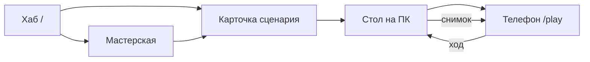

# story-tables

Платформа пошаговых сценариев для настольных ролевых игр. Автор собирает историю в мастерской, открывает **стол на компьютере**, игроки подключаются **с телефонов** и каждый ход делают одно действие: ждут, идут, осматривают, говорят, делятся уликой или применяют способность.

Живая сборка: [story-tables.vercel.app](https://story-tables.vercel.app).

Отдельного игрового сервера и базы данных нет. Правила считает вкладка хоста в браузере. Телефоны получают только свой срез состояния по WebRTC (PeerJS). Сценарии автора живут в `localStorage` этого браузера; канонический пример «Червуд» зашит в репозиторий.

Исходное продуктовое ТЗ мастерской: [docs/TZ-STUDIO.md](docs/TZ-STUDIO.md). Этот README описывает **то, что реально собрано** в коде на `main`, включая места, где реализация отстаёт от ТЗ.

---

## Роли за столом

| Роль | Где | Что делает |
|------|-----|------------|
| Автор | `/studio/:id` на ПК | Собирает локации, осмотры, NPC, шкалу ходов, персонажей, обложку |
| Хост | `/table/:code` на ПК | Держит партию в памяти, показывает QR, сам может занять роль и ходить |
| Игрок | `/play/:code?h=…` на телефоне | Выбирает роль, сдаёт один ход за раунд, видит свою локацию, улики и всплывающие события |

Хост — не отдельный «чистый мастер». Это тоже место за столом: пока он не возьмёт персонажа, кнопка «Начать дело» недоступна (нужна хотя бы одна занятая роль, и хост может быть этой ролью). Отдельного режима ведущего, который видит все приватные журналы и не ходит сам, нет.

---

## Маршруты

| Путь | Экран | Файл |
|------|--------|------|
| `/` | Хаб сценариев: свои черновики, встроенный Червуд, импорт JSON | `src/pages/HubPage.tsx` |
| `/project/:id` | Карточка перед игрой: обложка, число локаций и маркеров шкалы, кнопка «открыть стол» | `src/pages/ProjectPage.tsx` |
| `/studio/:id` | Мастерская | `src/pages/StudioPage.tsx` |
| `/table/:code` | Хаб стола (хост) | `src/pages/TablePage.tsx` |
| `/play/:code` | Клиент игрока | `src/pages/PlayPage.tsx` |

Код стола — 4 символа из алфавита без легко путаемых букв (`src/lib/ids.ts`). Какой сценарий открыт, хост запоминает в `sessionStorage` (`story-tables.project`), **не в URL**. Гость сценарий не скачивает: ему приходит уже посчитанный снимок партии.

Неизвестный путь уводит на `/`.

---

## Игровой цикл



1. Автор правит `ScenarioDocument` и жмёт «К столу», либо с хаба открывает «Играть».
2. Карточка проекта создаёт код комнаты и переходит на `/table/:code`.
3. Вкладка хоста поднимает `TurnEngine` и PeerJS-пир. В QR и в ссылке зашиты код комнаты и id пира (`?h=`). Кода комнаты одного недостаточно: у каждого запуска хоста новый суффикс пира.
4. Телефон шлёт `hello`, затем `claim` роли. Хост жмёт «Начать дело».
5. Все, у кого есть роль, стартуют в локации, на которую указывает нода `start`. Раунд становится 1, сразу срабатывает шкала на раунд 1.
6. Фаза всегда `planning`, пока все не сдадут ход. Один игрок — одно намерение: `wait` | `move` | `inspect` | `talk` | `share` | `ability`. Пока не сдались все, раунд не закрывается. Сданный ход можно отменить.
7. Разрешение одновременное: сначала все перемещения, потом остальные действия уже из новой точки (но одно намерение не бывает и «идти», и «осмотреть»).
8. Раунд увеличивается на 1, снимаются истёкшие кулдауны способностей, стреляет шкала нового раунда.

Приватность по умолчанию: текст осмотра, реплика NPC и личные улики пишутся в журнал и `lastResult` только этого игрока. «Показать здесь» копирует улику тем, кто **в той же локации**, и кладёт карточку на доску share. Общие события шкалы со `scope: "all"` приходят попапом всем; `same_location` — только тем, кто стоит в указанной комнате.

Журнал копит до 40 записей на игрока. Доска share хранит 12 последних карточек.

---

## Архитектура

Классического бэкенда нет. «Сервер правил» — класс `TurnEngine` внутри вкладки хоста. Если вкладку закрыть или обновить, партия пропадает: снимка партии на диск нет.

```text
ScenarioDocument          авторский JSON (мастерская / файл / Червуд)
        │
        ▼
compileScenario()         src/lib/scenario/compile.ts
        │
        ▼
GraphDocument +           комнаты, выходы, осмотры, NPC
TimelineRule[]            события по номеру раунда
        │
        ▼
TurnEngine                src/lib/turn-engine.ts
        │  snapshotFor(clientId) — личный срез, не весь мир
        ▼
PeerJS  host ↔ guests     src/lib/p2p.ts
        │
        ▼
TablePage / PlayPage      рисуют снимок, шлют намерения обратно
```

Два формата графа:

- **`ScenarioDocument`** (`src/lib/scenario/types.ts`) — то, что редактирует мастерская: ноды, рёбра, шкала, персонажи, обложка, id базы лора.
- **`GraphDocument`** (`src/lib/graph/types.ts`) — плоский рантайм: словарь локаций, выходы с флагами-воротами, осмотры, NPC с вариантами диалога. Его понимают `src/lib/graph/runtime.ts` и движок.

Старый ручной граф Червуда лежит в `src/projects/cherwood/graph.ts` и зарегистрирован в `src/projects/registry.ts`. В игре он почти не используется: `resolvePlayable` сначала берёт документ из `localStorage`, затем компилирует `cherwood/scenario.ts`, и только потом — legacy-граф. У этого запасного возврата к тому же не заполнены персонажи и `playersMax`, так что путь фактически мёртвый.

### Компиляция: что доезжает до партии

`compileScenario` переносит:

- локации (название, `locationId`, картинка фона = `data.background`);
- ребро локация→локация как выход (подпись ребра или название комнаты);
- ребро локация↔осмотр: подпись, текст результата, `once`, `setFlags`, `grantClue`;
- ребро локация↔NPC: имя, интро и **одна** реплика «Поговорить» (`body`), плюс флаги и улика;
- старт: ребро из ноды `start` в локацию;
- маркеры `doc.timeline` и ноды типа `timeline` (если из ноды есть ребро в событие — берётся текст события).

Не переносятся, хотя поля или экраны для них есть:

- ноды `branch` и любые условия на флагах (`requiresFlag` есть только у рантайм-графа);
- ноды `event`, если они не подвешены к ноде `timeline`;
- `sceneObjects` (вкладка «Сцена» и плавающее окно сцены) — в партию не попадают;
- `initialFlags` документа;
- ворота осмотра/диалога от способности (`requiresAbilityId` на ноде в граф не кладётся);
- несколько вариантов диалога у одного NPC;
- звук.

Если локаций нет, компилятор подставляет пустую комнату `room_1`, чтобы стол хотя бы открылся.

### Движок хода

Состояние в памяти экземпляра: места, флаги (`Record<string, boolean>`), локация каждого клиента, улики, журнал, уже осмотренное, использованные реплики, намерения, попапы, кулдауны способностей, номера раундов, на которых шкала уже стреляла.

Флаги только включаются, снять флаг нельзя. Ключ `unlock_<locationId>` выставляют шкала и эффект способности `unlock_location`. Прятать выход до этого ключа движок пытается, но условие хрупкое: скрытие включается лишь когда в мире уже есть хоть один флаг `unlock_*`, и только для комнат, которые кто-то на шкале пометил `unlockLocationId`. До первого такого флага «закрытая» дверь всё равно доступна, если до неё есть ребро.

`scope: "actor"` на маркере шкалы обрабатывается как «все»: отдельной ветки нет.

Способность тратит ход. Учитываются `oncePerGame` и `cooldownRounds`. Поле `requiresFlags` у способности **не проверяется**. Эффекты: личный / общий / «в этой комнате» текст-попап, улика, флаг, открытие локации. После применения ставится флаг `ability_used:<id>`. Шкала умеет пропустить маркер, если выставлен `requiresAbilityUsed` и такого флага нет — но в UI шкалы это поле не редактируется.

Лимит мест: `manifest.playersMax`, иначе не меньше 4 и не меньше числа персонажей. Константа `MAX_PARTY = 6` в `src/projects/roster.ts` — запасной потолок конструктора. Хост занимает одно место ещё в лобби.

---

## Снимок, который видит клиент

`TurnSnapshot` (`src/lib/turn-types.ts`) — единственный контракт UI и сети.

Игрок получает: код, название дела, фазу, номер раунда, список мест и ролей, свою роль, свою локацию (имя и url фона), NPC здесь, имена других в этой же комнате, доступные действия, своё намерение, счётчик «сдались / всего», свои улики и журнал, всю доску share, свои попапы, последний личный результат и последнюю публичную строку.

Чужие улики и чужие журналы в снимок не кладутся. Доска share кладётся **целиком всем**, хотя раздача улики идёт только соседям по комнате. Телефон доску не рисует; на ПК показывается только верхняя карточка.

Что экраны реально рисуют (даже если поле в снимке есть):

| Данные | Телефон | ПК-стол |
|--------|---------|---------|
| Имя локации, NPC, кто ещё здесь | да | только своё, если хост взял роль |
| Кнопки хода | да | да, если хост взял роль |
| Последний результат | да | да |
| Улики | да | нет |
| Журнал | нет | нет |
| Фон локации | нет | нет |
| Попап события | да | да |
| Share | нет | последняя карточка на весь стол |
| Карта «кто в какой комнате» | нет | нет |

Протокол PeerJS (`src/lib/p2p.ts`):

- Гость → хост: `hello`, `claim`, `start`, `intent`, `clearIntent`, `dismissPopup`.
- Хост → гость: `snapshot`, `actionResult`.

Брокер — публичный `0.peerjs.com:443`, STUN Google и Twilio. Своего сигнального сервера нет. Канал без аутентификации: кто знает `?h=`, тот садится за стол, пока есть места. Обрыв и обновление страницы гостя лечатся только новым подключением; движок гостя у себя не помнит.

---

## Мастерская

Четыре вкладки (`StudioPage`):

1. **Превью** — название, подзаголовок, blurb, обложка, min/max игроков, статус `draft | playable`. Так карточка выглядит на `/project/:id`.
2. **План** — шкала раундов (1…24) и канвас комнат. Тянутся порты «выход → вход». Внутри комнаты кнопками добавляются NPC и осмотры (это отдельные ноды, связанные портом `events`, на канве как рёбра не рисуются). Инспектор комнаты: название, сырой `locationId`, описание для автора, фон URL или файл. У NPC — имя, интро, одна реплика, URL портрета. У осмотра — подпись, текст результата, галочка «один раз». Кнопка «Превью сцены» открывает плавающее окно.
3. **Сцена** — доска поверх фона: хотспоты и подписи, перетаскивание. Это раскадровка, не игровые кнопки.
4. **Персонажи** — имя, предыстория, портрет файлом. Если у сценария включена база лора, здесь выбираются путь и последовательность; в роль записываются все способности этой последовательности и более слабых (в LoTM меньший номер последовательности сильнее, поэтому берутся ранги `>=` выбранного).

Кнопка **«Лор»** на плане открывает справочник путей: сейчас одна база, `lotm`. Её можно прикрепить к сценарию или снять. Справочник ничего в граф сам не вставляет — только включает пакет для персонажей.

**Ассеты** — общая для браузера библиотека (`IndexedDB` + оглавление в `localStorage`), не привязанная к id сценария жёстко. Файл с диска сохраняется как blob; в документ пишется `blob:`-URL. Такой URL умирает после перезагрузки и не открывается на чужом телефоне. Рабочий для партии фон — обычный `https://` URL.

Сохранение — на каждое изменение, ключ `story-tables.scenarios.v1`. Export / Import — весь `ScenarioDocument` одним JSON. Удаление с хаба стирает только этот ключ, не файлы в IndexedDB.

Пустой сценарий сразу содержит старт, одну комнату, двух персонажей без лора и пример маркера на 5-й ход.

На канве в типе нод есть `event` и `branch`, и фильтр канвы их не прячет, но кнопок «добавить событие / ветку» нет, инспектор для них — только заголовок (у события ещё текст). Для автора рабочий путь шкалы — полоска `TimelineStrip`, не ноды.

Чего в инспекторах нет, хотя модель и компилятор поля уже понимают: выдача улики, список флагов, условие «показать, если флаг», несколько реплик NPC, открытие локации и улика на маркере шкалы, привязка события к способности. В Червуде это заполнено руками в `scenario.ts`. С нуля в UI такого сюжета не собрать — только линейные комнаты, тексты осмотров и объявления по раундам.

---

## База лора LoTM

Пакет `src/lib/lore/lotm/` — фанатский справочник по новелле «Повелитель тайн» / Lord of the Mysteries. Это не официальный продукт и не лицензированный модуль: имена путей и последовательностей взяты из канона как опора для домашних сценариев, механики упрощены под этот движок.

Контракт любой базы — `LoreBase` (`src/lib/lore/types.ts`): пути → последовательности рангов 9…4 → способности. Реестр баз — `src/lib/lore/registry.ts`. Чтобы добавить вторую систему, достаточно ещё одного объекта `LoreBase` и строки в `BASES`.

Сейчас в пакете 22 пути, последовательности с 9 по 4. У каждой есть короткий `profileRu` (карточка персонажа, `profiles.ts`). Боевой текст способностей («богатые» эффекты, не заглушка) есть точечно, в первую очередь у пути Дурака с 9 по 4 и у девятых последовательностей части других путей. Остальные последовательности получают одну заглушку: ход тратится, кулдаун 1 раунд, игроку показывается общий текст «вы опираетесь на силу пути», ставится флаг. Способность не бросает кубик, не проверяет сложность и сама по себе не открывает осмотр, пока автор явно не завяжет флаг `ability_used:…` — а UI для такой завязки ещё нет.

На телефоне способность выглядит как ещё одна кнопка хода с префиксом `✧`.

---

## Встроенный сценарий: Червуд

«Червудский свидетель», акт I, пансион «Серебряная чайка». Детектив на 1–4 игроков.

Пять локаций: улица Железных ворот, гостиная, коридор второго этажа, комната 7, дверь в подвал. Осмотры и три NPC (Клара, Хэтти, Пелл) раздают улики и ставят флаги. Четыре роли без пути LoTM: следователь, медиум, врач, взломщик. На 5-м раунде всем приходит «за вами следят». На 10-м — «крик со двора», улика и `unlockLocationId: basement` (из-за логики замков выше подвал при этом не обязан быть закрыт раньше).

Два источника:

- `src/projects/cherwood/scenario.ts` — то, чем реально играют и что мастерская импортирует в `localStorage`;
- `src/projects/cherwood/graph.ts` — более старый граф, где часть реплик спрятана за `requiresFlag`. Компилятор сценария эти ворота не воспроизводит, поэтому в текущей партии флаги Червуда пишутся, но почти ничего не закрывают.

Кнопки хаба: «Червуд в мастерской» копирует канон в `localStorage`, если копии ещё нет; «Сбросить Червуд» перезаписывает локальную копию файлом из кода. Пока локальная копия есть, правка файла в репозитории игру не меняет.

---

## Стек и запуск

- Vite 6, React 19, React Router 7, TypeScript (strict).
- PeerJS 1.5, `qrcode`.
- Стили — один `src/styles.css` и инлайн-стили. Тёмная «латунь и бумага», шрифты Cormorant Garamond и Figtree с Google Fonts.
- Алиас `@` → `src/`.
- Тестов, линтера и CI в репозитории нет.

```bash
npm install
npm run dev    # vite, порт 5173, host: true
npm run build  # dist/
npm run preview
```

Деплой на Vercel описан в `vercel.json`: любой путь отдаёт `index.html`. Framework Vite, build `npm run build`, output `dist`. `public/BUILD.txt` — ручной штамп (`clean-v0.1.0`); на хабе отдельно зашита строка `preview-tab-v0.8`, к файлу она не привязана.

---

## Каталог

```text
src/pages/            экраны маршрутов
src/components/       канвас, шкала, сцена, персонажи, лор, ассеты, попап
src/lib/scenario/     документ, compile, localStorage, resolve, сид Червуда
src/lib/graph/        рантайм-граф и проверки флагов
src/lib/turn-engine.ts
src/lib/turn-types.ts
src/lib/p2p.ts
src/lib/lore/         типы баз + пакет LoTM
src/lib/assets/       IndexedDB-библиотека файлов
src/projects/         встроенные манифест, сценарий и legacy-граф Червуда
docs/TZ-STUDIO.md     целевая модель мастерской (S0–S5)
```

Версия документа сценария: `version: 1`. Ломающих миграций нет: импорт проверяет только `manifest.id` и массив `nodes`.

---

## Как собрать текстовый сценарий сейчас

Практический потолок UI, без правки TypeScript:

1. Новый сценарий с хаба.
2. Превью: название, blurb, лимит игроков.
3. План: комнаты, рёбра-выходы с подписью, внутри комнат осмотры (текст результата) и NPC (одна реплика).
4. Шкала: на нужном раунде заголовок и текст всем или одной комнате.
5. Персонажи. По желанию включить LoTM и выдать путь — способности появятся кнопками сами.
6. Export JSON, если нужно перенести на другой браузер. Картинки — только постоянными https-ссылками.
7. «К столу» → QR на телефоны. Хост-вкладку не обновлять до конца партии.

Улики, которые можно «показать здесь», ветвления по флагам и закрытые до срока двери из одного только UI не задаются. Их можно дописать в экспортированный JSON (`grantClue`, `setFlags`, а для шкалы ещё `unlockLocationId`) и импортировать обратно — компилятор эти поля читает. Условия «доступно, только если флаг» в JSON сценария компилятор пока не подхватывает: такого поля на ноде он в граф не кладёт.

---

## Статус относительно ТЗ

| Этап ТЗ | Состояние |
|---------|-----------|
| S0 каталог и документ | есть: хаб, localStorage, import/export |
| S1 канвас локаций и выходов | есть |
| S2 осмотр / NPC / флаги → рантайм | осмотр и один диалог есть; флаги компилируются, если они уже в JSON; в UI их не задать; условий на флагах нет |
| S3 шкала на раунд | есть как полоска, не как ноды; попап и журнал работают; улика и unlock — только из данных |
| S4 ветки и плейтест из мастерской | веток нет; «К столу» открывает карточку, не встроенный плейтест |
| S5 убрать hardcoded Червуд | не сделано: канон всё ещё в коде, плюс legacy-граф |

За рамками ТЗ и по-прежнему не сделано: общий AI-генератор нод, совместное редактирование, серверная БД сценариев.
